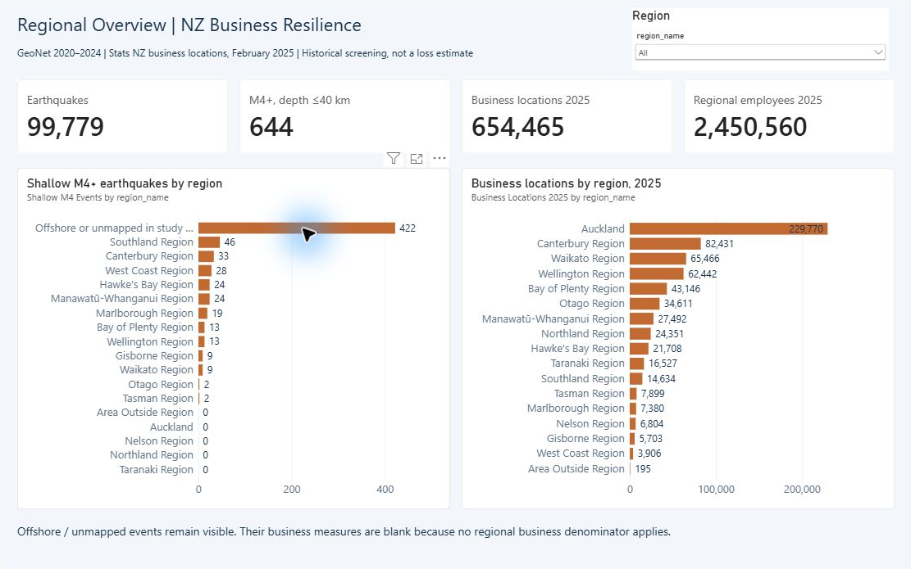
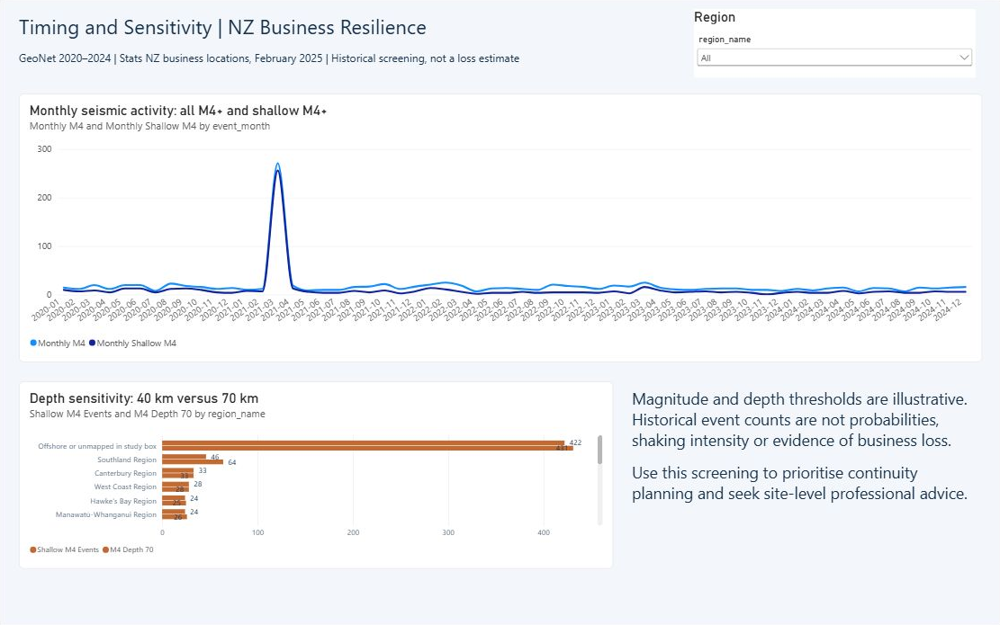

# New Zealand business and earthquake analytics

A data and visualisation portfolio by **Ming Zhao**. This is the **MBI807B Assessment 1 — NZ Earthquake Business** project. Reports, assessment briefs, Turnitin files, student numbers, meeting recordings and demo videos are excluded from this public edition.



## Data and presentation

- **99,779** accepted earthquake events from 100,739 retrieved GeoNet records (2020–2024 study box).
- **82,489** events matched to a region; **17,290** offshore/unmapped events retained visibly rather than silently dropped.
- **170** region-year business records; **654,465 business locations** in the February 2025 reference data.
- Python ETL, constrained SQLite schema, separate earthquake and business facts, regional/monthly aggregates, a three-page editable Power BI project and the presentation deck.

Earthquake counts describe historical seismicity. Business locations describe regional activity. Their co-location is a continuity-screening prompt, **not predicted earthquake risk, expected losses or a causal estimate of business impact**. Business locations are geographic units, not unique enterprises. The regional employee sum (2,450,560) differs from the published national total (2,450,600); retain the rounding distinction.



## Files

| Location | Contents |
|---|---|
|`data/`|Concise aggregate tables and reconciliation counts|
|`TechnicalPortfolio/01_Database/schema.sql`|Database constraints and analytical views|
|`TechnicalPortfolio/02_ETL_Code/`|ETL, validation, source download and Power BI preparation code|
|`TechnicalPortfolio/04_Data_Examples/Clean_Data/`|Regional, monthly, annual and threshold-sensitivity CSVs|
|`TechnicalPortfolio/04_Data_Examples/Raw_Data/source_manifest.json`|Public URLs, retrieval time and hashes of the original snapshot|
|`TechnicalPortfolio/03_Dashboards/NZ_Business_Resilience_Project/`|Editable native Power BI PBIP source; local paths prepared by the helper below|
|`presentations/`|Presentation without student identifiers|
|`visuals/`|Dashboard previews and the accepted-event annual chart|

## Reproduce locally

```bash
pip install -r TechnicalPortfolio/02_ETL_Code/requirements.txt
python TechnicalPortfolio/02_ETL_Code/download_sources.py
python TechnicalPortfolio/02_ETL_Code/run_etl.py
python TechnicalPortfolio/02_ETL_Code/validate_solution.py
python TechnicalPortfolio/02_ETL_Code/prepare_powerbi.py
```

Open `NZ_Business_Resilience.pbip` in Power BI Desktop, refresh, and save a PBIX. The large original earthquake CSV, SQLite database and cached PBIX are intentionally omitted; the download and ETL steps generate local inputs. No report upload is required. The source-only project will not refresh until those inputs are prepared. The screenshots show the original validated snapshot.

The source manifest records an October 2026 retrieval. Live GeoNet or Stats NZ endpoints may change; use `--strict-hashes` to detect any difference from the historical inputs, and revalidate before claiming exact reproduction. The regional boundary year is 2025 while earthquake history is 2020–2024; this is an explicit analytical alignment, not a timeless geography assumption.

## Attribution and scope

Source attribution: **GeoNet earthquake catalogue**, **Stats NZ business demography at February 2025**, and **Stats NZ Regional Council 2025 boundaries**. Exact URLs are in the manifest. Source-provider licence, attribution and reuse terms apply; no blanket repository licence replaces them. This is an academic prototype and does not claim operational deployment, realised business benefit or an awarded grade.
